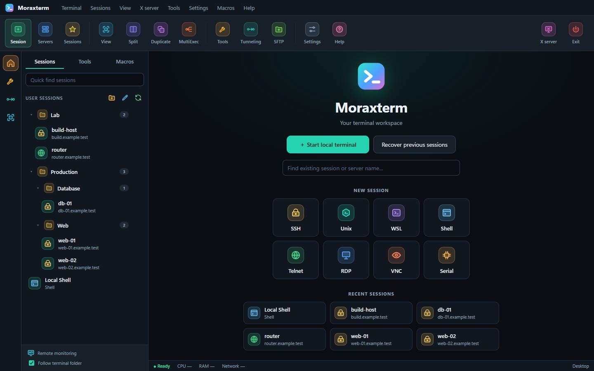

[English](README.md) | [فارسی](README.fa_IR.md)

# Moraxterm

**Moraxterm** is a cross-platform terminal workspace and SSH client for **Windows and Linux**: local shells, SSH, SFTP, saved sessions, split panes, and MultiExec in one window.

It is an independent, clean-room implementation built with [**Tauri 2**](https://tauri.app/), a **Rust** core, and [**xterm.js**](https://xtermjs.org/). It does not copy third-party proprietary source or assets, and it does not claim pixel-perfect parity with any other application.

[](https://github.com/alimoradimllm/moraxterm/releases/latest)
[](https://github.com/alimoradimllm/moraxterm/actions/workflows/build-linux.yml)
[](https://github.com/alimoradimllm/moraxterm/actions/workflows/security.yml)

> **Early software.** Version 0.1.x. The status table below says exactly what has been run and what has not.



<sub>Real screenshot of the built app on Windows (v0.1.25 build), made with demo sessions on `example.test` hosts. Also in a [light theme](docs/screenshots/workspace-light.png).</sub>

## ✨ Features

- 🖥️ **Local shells**: `cmd`, PowerShell, and an embedded Unix (Fish) runtime on Windows; the system shell on Linux.
- 🗂️ **Saved sessions**: a folder tree backed by SQLite, favorites, recent sessions, import, and sanitized JSON backup and restore.
- 🔐 **SSH**: structured native-process arguments, ProxyJump, host-key policy, SSH-agent forwarding, persistent private-key identity paths, and OS keyring credentials (never stored in session records).
- 📁 **SFTP browser**: list, create, rename, delete, permissions, upload, download, resume, retry, and cancel.
- 🪟 **Tabs and split view**: duplicate a session and run two terminals side by side.
- ⇄ **MultiExec**: type once and it goes to every selected terminal, with a persistent banner, Multi-paste (`Ctrl+Shift+Insert`), a per-terminal *Exclude* checkbox, and `✓ sent` / `✕ failed` indicators.
- 🧰 **Operator tools**: SSH tunnels, macros, terminal recording, network checks, and X11 status.
- 🔌 **More protocols** (launch planning): WSL, RDP, VNC, Telnet, and Serial.

## 📋 What has actually been verified

| Area | Status |
|---|---|
| Local shells on Windows (`cmd`, PowerShell, embedded Fish) | ✅ Run in the built app |
| Tabs, duplicate, split view | ✅ Run in the built app (local PowerShell) |
| MultiExec: banner, mirrored typing, exclude, Multi-paste, `Ctrl+Shift+Insert`, Exit | ✅ 17 checks in the built app across three local shells |
| ConPTY behaviour: Unicode, resize, `Ctrl+C`, `vim`/`less` alternate screen, 20 000-line output | ✅ Automated PTY tests (`rust-core/tests/windows_pty_matrix.rs`); the same checks in the app are partly done |
| SFTP commands: list, mkdir, rename, chmod, upload, download, resume, cancel | ✅ Tested against a throwaway local `sshd`; ⚠️ the SFTP screen itself is untested |
| SSH host-key trust (unknown, approved, changed key; gateway) | ✅ OpenSSH-level harness passes; ⚠️ the in-app flow is untested |
| SSH login from the app | ✅ Saved private-key identity verified against a disposable loopback sshd; ⚠️ password/passphrase and SFTP login remain open |
| WSL, RDP, VNC, Telnet, Serial | ⚠️ Launch planning only, not run |
| Tunnels, macros, recording, X server | ⚠️ Implemented, not run |
| Linux `.deb` / `.rpm` | ✅ Built on every change in CI; the `.deb` installs in a clean Ubuntu 24.04 container and stays running under a virtual display. ⚠️ Not published, and nobody has used it on a real Linux desktop |

The full list of open work is in [`docs/REMAINING_WORK.md`](docs/REMAINING_WORK.md), and the Windows terminal checks are in [`docs/WINDOWS_TERMINAL_TEST_MATRIX.md`](docs/WINDOWS_TERMINAL_TEST_MATRIX.md).

## 📦 Download

**Windows**: get the latest installer from the [Releases page](https://github.com/alimoradimllm/moraxterm/releases/latest):

- `Moraxterm_0.1.24_x64-setup.exe` (NSIS installer)
- `Moraxterm_0.1.24_x64_en-US.msi`

Releases include `SHA256SUMS` with a Sigstore signature (`SHA256SUMS.sig`, `SHA256SUMS.pem`). The installed program is named `moraxterm-linux-ui.exe`, a name kept from the original build pipeline.

**Linux**: no package is published yet. Every pull request and push to `main` builds a `.deb` and `.rpm` in CI. Download them from the *Build Linux packages* run under the [Actions tab](https://github.com/alimoradimllm/moraxterm/actions/workflows/build-linux.yml) (artifact `moraxterm-linux-packages`), then:

```bash
sudo apt install ./Moraxterm_0.1.24_amd64.deb
```

## 🛠️ Build from source

You need Node.js 22, a current stable **Rust** installed with [rustup](https://rustup.rs/) (the distribution `rustc` packages are too old for this project's dependencies), and Python 3.

### Linux (Debian/Ubuntu)

```bash
sudo apt install libwebkit2gtk-4.1-dev libgtk-3-dev libayatana-appindicator3-dev \
  librsvg2-dev libssl-dev libxdo-dev build-essential pkg-config

cd tauri-ui
npm ci
npm run tauri -- build --bundles deb,rpm
```

A clean checkout builds on Linux without extra files. The packages appear under `tauri-ui/src-tauri/target/release/bundle/`.

### Windows

Windows packaging needs the embedded Unix runtime archive, which is too large to commit to git:

```cmd
python scripts\prepare_embedded_runtime.py --url https://github.com/alimoradimllm/moraxterm/releases/download/v0.1.24/Moraxterm_EmbeddedUnix_x64_0.1.24.tar.xz
build-tauri-windows.cmd --bundles nsis
```

The helper loads the Visual Studio build environment, then builds the executable and the NSIS installer.

## ✅ Tests

```bash
cd rust-core && cargo test                 # core, PTY, SQLite, import, SSH planning
cd tauri-ui  && npm run test:unit          # frontend logic (MultiExec routing, icons)
cd tauri-ui/src-tauri && cargo test        # native bridge
python -m unittest discover -q             # Python reference, CLI, docs-sync tooling
```

Desktop UI checks drive the built app over WebView2 remote debugging with an isolated profile (`scripts/ui_smoke_test.py`, `scripts/ui_multiexec_test.py`). SSH and SFTP tests use a throwaway local server (`scripts/disposable_*.sh`) and never real hosts or credentials.

## 🏗️ Architecture

```text
Tauri 2 + Vite + React + xterm.js
              |
              v
       Rust Tauri bridge
              |
              v
      Rust core (rust-core)
       |       |        |
     PTY    SQLite   command planners
              |
              v
 OpenSSH, SFTP, WSL, FreeRDP, VNC, Telnet, ping, DNS
```

| Area | Main files |
|---|---|
| Desktop UI | `tauri-ui/src/App.tsx` and the other `tauri-ui/src/*.tsx` panels |
| Native bridge | `tauri-ui/src-tauri/src/main.rs` |
| Core model, PTY, SQLite | `rust-core/src/lib.rs` |
| Python reference, CLI, fallback GUI | `session_model.py`, `ssh_backend.py`, `moraxterm_cli.py`, `moraxterm_gui.py` |
| Packaging | `build-deb.sh` (legacy Python package), `build-tauri-windows.cmd`, `.github/workflows/` |

`tauri-ui/src/main.js` is the older JavaScript UI, kept until the React UI reaches parity.

## 🔒 Security model

- Imports are read-only and drop secret-looking fields.
- SQLite stores session metadata, never passwords or private keys.
- Commands are built from structured arguments, never from shell strings, and passwords never appear in arguments.
- Credentials go to the OS keyring (Windows Credential Manager, Linux Secret Service).
- A versioned local vault format uses Argon2id and XChaCha20-Poly1305 for authenticated encryption; lock/unlock UI, encrypted export/import, and team/cloud sync remain unimplemented.
- The desktop named-identity vault uses the `com.moraxterm.identity` keyring namespace. The legacy Python `credential_store.py` helper uses its separate `moraxterm-linux` Secret Service namespace; credentials are not implicitly portable between those interfaces.
- Backups remove sensitive environment keys and credential-like startup commands.
- Host fingerprints and key material are never committed; reports use `[REDACTED]`.

## 🤝 Contributing

Several people or agents can work at once. Read [`AGENTS.md`](AGENTS.md) first: it explains the branch and worktree rules, the per-change `docs/changes/` file that every code change needs, and the hooks that push your branch after each commit. Changes reach `main` through reviewed pull requests; nobody pushes to `main` directly.

See [`CONTRIBUTING.md`](CONTRIBUTING.md) to get started.

More: [remaining work](docs/REMAINING_WORK.md) · [compatibility roadmap](docs/MORAXTERM_COMPATIBILITY_ROADMAP.md) · [product strategy](docs/COMPETITIVE_PRODUCT_STRATEGY.md)

## Recent changes

<!-- RECENT-CHANGES:START -->
- 2026-10-20 — [Evaluate Windows OpenSSH FIDO2 capability honestly](docs/changes/2026-10-20-2348-fido2-windows-status.md)
- 2026-10-20 — [Define local-only vault sync and team protocol boundary](docs/changes/2026-10-20-2344-vault-sync-boundary.md)
- 2026-10-20 — [Verify disposable SFTP UI boundary and sanitize failures](docs/changes/2026-10-20-2342-sftp-ui-runtime.md)
- 2026-10-20 — [Add portable Windows bundle staging and profile isolation](docs/changes/2026-10-20-2338-portable-windows.md)
- 2026-10-20 — [Add SSH certificate metadata and public-key export planning](docs/changes/2026-10-20-2334-ssh-cert-public-key.md)
- 2026-10-20 — [Add honest X11 forwarding configuration and status](docs/changes/2026-10-20-2330-x11-forwarding-status.md)
- 2026-10-20 — [Add structured legacy protocol launch adapters](docs/changes/2026-10-20-2250-legacy-protocol-adapters.md)
- 2026-10-20 — [Add versioned authenticated local vault format](docs/changes/2026-10-20-2215-encrypted-vault-foundation.md)
- 2026-10-20 — [Add structured Mosh session launch support](docs/changes/2026-10-20-2156-mosh-protocol-launch.md)
- 2026-10-20 — [Harden shared identity writes and deletion](docs/changes/2026-10-20-2134-identity-safety-acceptance.md)

_62 change file(s) in [docs/changes/](docs/changes/); this list is generated by `scripts/docs_sync.py`._
<!-- RECENT-CHANGES:END -->

Every change is recorded as a file in [`docs/changes/`](docs/changes/) and listed here automatically.

## 📄 License

Moraxterm's source code is released under the [MIT License](LICENSE). Contributions are welcome under the same license (see [`CONTRIBUTING.md`](CONTRIBUTING.md)).

The Windows installer also redistributes an embedded Unix runtime (MSYS2, including programs such as Fish and Bash) that keeps its own licenses. [`THIRD_PARTY_NOTICES.md`](THIRD_PARTY_NOTICES.md) lists what was checked and what is still missing, including license texts that have not been added yet.

Moraxterm is an independent, clean-room implementation. It is not affiliated with or endorsed by any other terminal application or its publisher.
